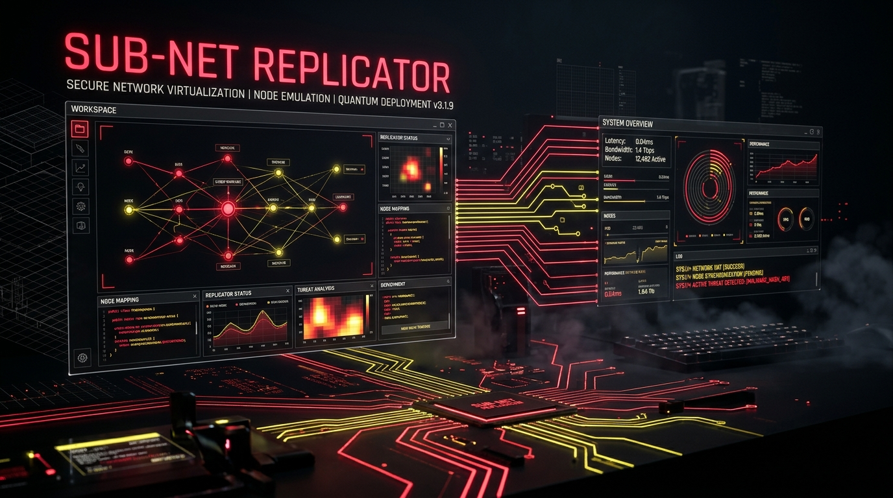
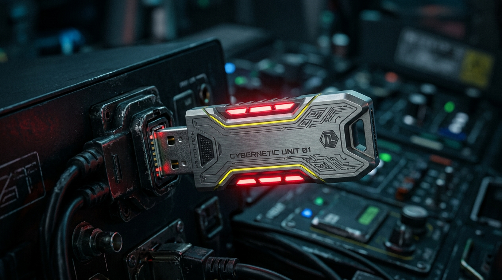

<p align="center">
  
</p>

<p align="center">
  <a href="https://github.com/AceRevo/subnet-replicator/releases"></a>
  
  
  
  
</p>

---

# ⚡ SUB-NET REPLICATOR
> **Herramienta portable de alto rendimiento para replicar proyectos IDE desde cualquier pendrive USB.**  
> *Desarrollado en Rust con arquitectura incremental ultra-rápida y estética de terminal de alta tecnología.*

---

## 🌐 Descripción General / Overview

Trabajar entre múltiples estaciones de trabajo (computadoras de laboratorio, universidad, oficina y laptops personales) presenta desafíos comunes al respaldar proyectos:
- Las soluciones en la nube suelen bloquear archivos en compilación, consumir ancho de banda o requerir software instalado con privilegios de administrador.
- Copiar y pegar carpetas completas de proyectos es lento y copia una y otra vez dependencias que no han cambiado.
- Entornos restringidos a menudo bloquean la ejecución de scripts (`.bat` o `.ps1`) mediante directivas del sistema operativo.

**Sub-Net Replicator** resuelve esto en un **único archivo ejecutable nativo (`.exe`)** diseñado para vivir en la raíz de cualquier unidad USB / pendrive. Se conecta a cualquier equipo, se ejecuta con doble clic, detecta automáticamente los proyectos de IntelliJ IDEA / JetBrains y sincroniza de forma incremental únicamente los archivos nuevos o modificados en milisegundos.

---

<p align="center">
  
</p>

---

## ⚡ Características Principales

- **🚀 Binario 100% Autónomo y Portable:** Un único archivo `.exe` compilado en Rust. No requiere DLLs externas, ni Python, ni scripts secundarios, ni permisos de Administrador.
- **🔍 Detección Inteligente Multicanal:**
  - Rastreo en rutas estándar (`%USERPROFILE%\IdeaProjects`, carpetas de documentos).
  - Parser de configuración histórica (`recentProjects.xml`) para descubrir proyectos en rutas personalizadas.
  - Modo interactivo para sincronizar cualquier directorio manual si se requiere.
- **⚡ Sincronización Incremental Optimizada:** Compara metadatos de tamaño y fecha de modificación (`mtime`). Si un proyecto no ha cambiado, se valida en **0.00 segundos** sin sobreescrituras innecesarias en la memoria flash.
- **🛡️ Bóveda Segura y No Destructiva:** Sincroniza de forma acumulativa y segura. Nunca elimina respaldos previos en el USB si se borraron del equipo anfitrión.
- **🎨 Interfaz de Terminal Futurista:** Presenta una interfaz de línea de comandos en modo 24-bit TrueColor con paleta crimson, dorado de alerta y cian de datos.
- **📊 Registro de Auditoría Local:** Genera automáticamente un log estructurado (`subnet_audit.log`) con estadísticas de transferencia, número de archivos procesados y nombre de la máquina anfitriona.

---

## 🖥️ Demostración de Interfaz CLI

```text
  ███████╗██╗   ██╗██████╗       ███╗   ██╗███████╗████████╗
  ██╔════╝██║   ██║██╔══██╗      ████╗  ██║██╔════╝╚══██╔══╝
  ███████╗██║   ██║██████╔╝█████╗██╔██╗ ██║█████╗     ██║   
  ╚════██║██║   ██║██╔══██╗╚════╝██║╚██╗██║██╔══╝     ██║   
  ███████║╚██████╔╝██████╔╝      ██║ ╚████║███████╗   ██║   
  ╚══════╝ ╚═════╝ ╚═════╝       ╚═╝  ╚═══╝╚══════╝   ╚═╝   
       NEURAL SUB-NET PROJECT REPLICATOR // v1.0
----------------------------------------------------------------------
 [SYSTEM IDENT]  NODE_HOST: WORKSTATION-01 | AGENT_USER: dev_user
 [DATA VAULT ]  REMOVABLE VAULT: D:\
 [SECURITY   ]  CLEARANCE: LEVEL 5 // SECURE SYNC PROTOCOL
----------------------------------------------------------------------

[+] DESPLEGANDO SONDA DE ESCANEO EN RUTAS LOCALES...
[✓] ESCANEO COMPLETO: 37 PROYECTOS IDENTIFICADOS:

  [01] adatosjdbc                   // ORIGEN: IdeaProjects
  [02] EjemploMaven                 // ORIGEN: IdeaProjects
  [03] KotlinPractica               // ORIGEN: IdeaProjects
  [04] DatabaseMicroservice         // ORIGEN: IDE History
  ...

----------------------------------------------------------------------
 [DESTINO] D:\Respaldos_IntelliJ\Proyectos
 [PROTOCOLO] Replicación Incremental Multi-Cluster
----------------------------------------------------------------------

[SUB-NET PROTOCOL] -> Presiona [ENTER] para replicar (o 'Q' para salir):

[+] SINCRONIZANDO PROYECTOS CON LA UNIDAD USB...
  [01/37] adatosjdbc                   ... [ACTUALIZADO // SIN CAMBIOS]
  [02/37] EjemploMaven                 ... [REPLICADO // 34 ARCHIVOS // 1.25 MB]
  [03/37] KotlinPractica               ... [ACTUALIZADO // SIN CAMBIOS]

----------------------------------------------------------------------
 [✓] ¡REPLICACIÓN FINALIZADA CON ÉXITO!
 Total Proyectos Asegurados : 37
 Archivos Sincronizados     : 34 nuevos/modificados
 Tiempo de Ejecución        : 0.78s
 Bóveda de Almacenamiento   : D:\Respaldos_IntelliJ\Proyectos
 Registro de Auditoría      : D:\Respaldos_IntelliJ\recursos\subnet_audit.log
----------------------------------------------------------------------
```

---

## 📁 Estructura en la Unidad USB

```text
D:\ (Raíz de la unidad USB / Pendrive)
 ├── ⚡ SUBNET_REPLICATOR.exe      # Ejecutable standalone principal
 ├── 📄 INSTRUCCIONES.txt          # Guía rápida para cualquier usuario
 └── 📁 Respaldos_IntelliJ\
      ├── 📁 Proyectos\            # Todos tus proyectos replicados intactos
      └── 📁 recursos\
           └── 📝 subnet_audit.log # Registro histórico de sincronizaciones
```

---

## 🚀 Guía Rápida de Uso (Plug & Play)

1. **Descargar:** Obtén `SUBNET_REPLICATOR.exe` desde la sección [Releases de GitHub](https://github.com/AceRevo/subnet-replicator/releases/latest).
2. **Copiar:** Pega `SUBNET_REPLICATOR.exe` directamente en la raíz de cualquier pendrive o disco externo USB.
3. **Conectar:** Inserta el USB en cualquier computadora con Windows y haz doble clic en `SUBNET_REPLICATOR.exe`.
4. **Sincronizar:** Presiona `ENTER` para confirmar los proyectos detectados y respaldar en segundos.

---

## 🛠️ Compilación desde el Código Fuente

### Requisitos Previos
- [Rust & Cargo](https://www.rust-lang.org/) (versión 1.70 o superior)
- Target: `x86_64-pc-windows-gnu` o `x86_64-pc-windows-msvc`

### Instrucciones de Compilación
```bash
# Clonar el repositorio
git clone https://github.com/AceRevo/subnet-replicator.git
cd subnet-replicator

# Compilar el binario optimizado en modo release
cargo build --release

# El ejecutable compilado estará disponible en:
# target/release/subnet_replicator.exe
```

---

## 📄 Licencia

Este proyecto está distribuido bajo la licencia [MIT](LICENSE). Libre para uso educativo, personal y comercial.
